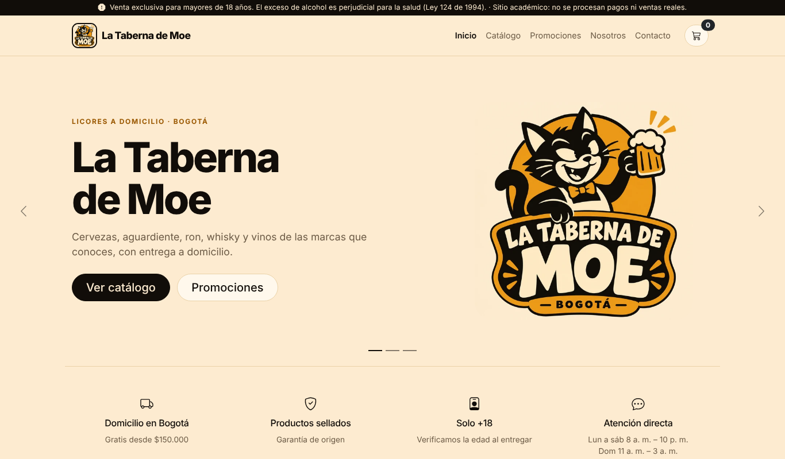
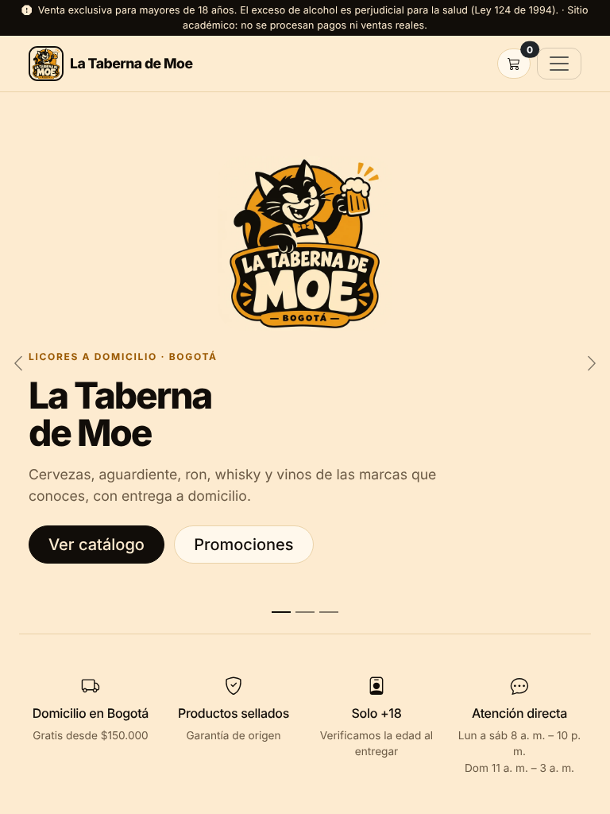
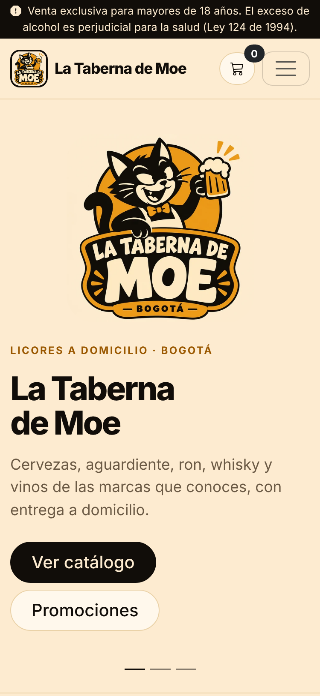
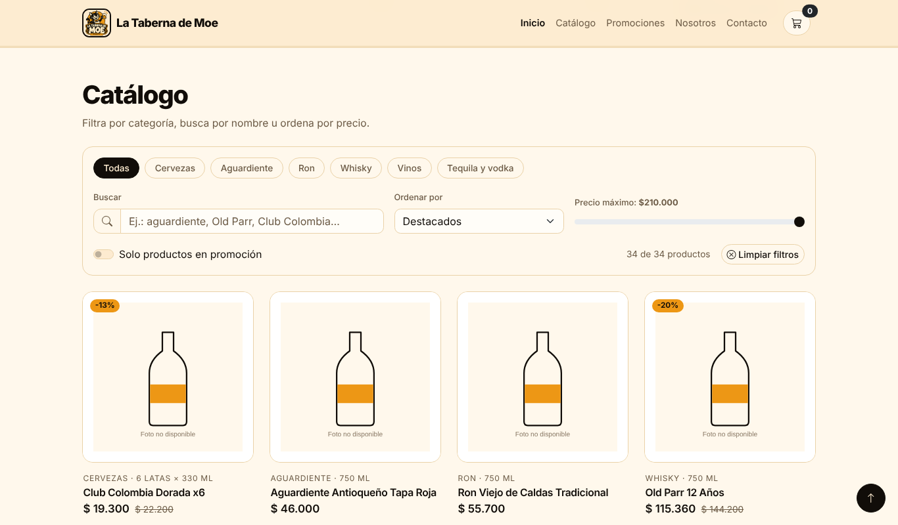
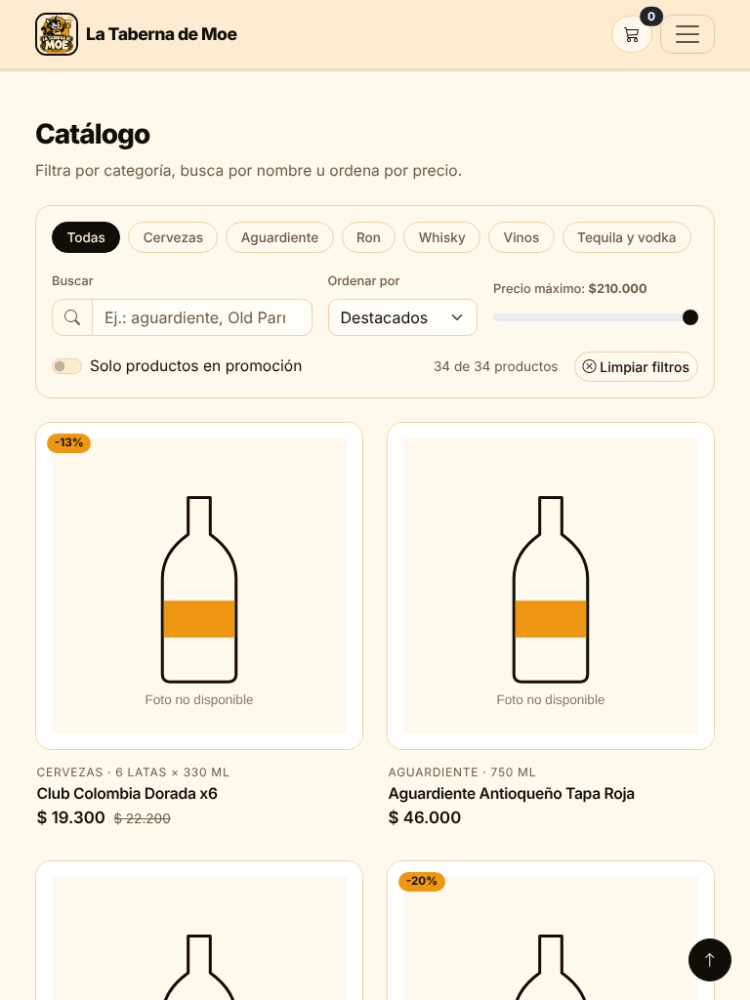
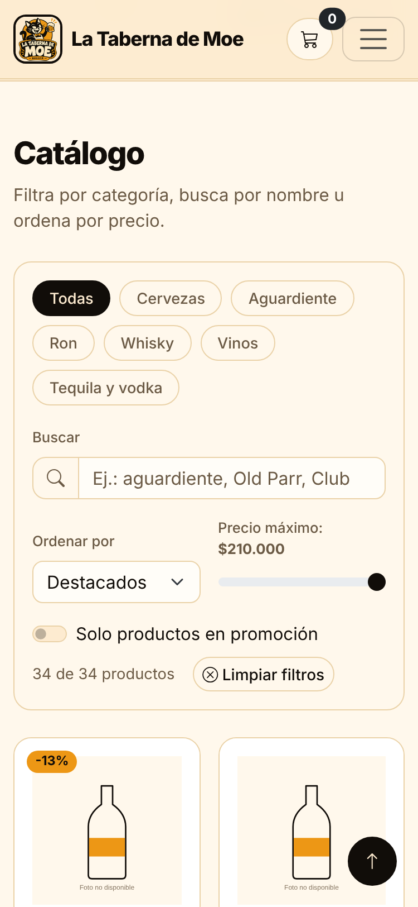

# La Taberna de Moe — Distribuidora de bebidas (proyecto académico)

Sitio web comercial **responsive** de una distribuidora de bebidas alcohólicas ficticia, desarrollado con **HTML5, CSS3, Bootstrap 5 y JavaScript** para el *Taller Bootstrap + GitHub Pages + JS* (Opción A).

> Proyecto académico. Los **productos, precios y fotos son reales**: se tomaron de Almacenes Éxito el 2 de noviembre de 2026 (ver [`docs/fuentes-precios.md`](docs/fuentes-precios.md)). **No se procesan pagos ni ventas reales.** Venta exclusiva para mayores de 18 años.

**Dirección:** Cra. 3 #22-50, Bogotá · **Correo:** pedidos@tabernamoebogota.com
**Horario:** lunes a sábado de 8:00 a. m. a 10:00 p. m. · domingos de 11:00 a. m. a 3:00 a. m.

- **Sitio publicado (GitHub Pages):** `https://ImJustice.github.io/taberna-de-moe/`
- **Repositorio:** `https://ImJustice.com/USUARIO/taberna-de-moe`

---

## 1. Descripción

La Taberna de Moe es la cantina del barrio que ahora vende a domicilio. El sitio permite:

- Verificar la mayoría de edad antes de entrar (fecha de nacimiento).
- Ver un **catálogo de 34 productos reales** con foto: 8 cervezas y refajo (Club Colombia, Águila, Poker, Heineken, Andina, Cola y Pola, Corona) y 26 licores (aguardiente, ron, whisky, vino, tequila y vodka) de marcas como Antioqueño, Néctar, Viejo de Caldas, Ron Medellín, Bacardí, Old Parr, Buchanan's, Johnnie Walker, Jack Daniel's, Casillero del Diablo, José Cuervo y Smirnoff, con precios y ofertas reales.
- **Filtrar** por categoría, **buscar** por texto, **ordenar** por precio/nombre, limitar por **precio máximo** y ver **solo promociones**.
- Ver el **detalle** de cada producto en un modal y elegir la cantidad.
- Usar un **carrito simulado**: agregar, sumar/restar, quitar, vaciar, aplicar **cupones** y calcular **subtotal, descuento, envío, IVA y total**. El carrito se guarda en `localStorage`.
- **Finalizar un pedido simulado** con formulario validado y número de pedido.
- Enviar un **formulario de contacto** validado.

## 2. Tecnologías

| Tecnología | Uso |
|---|---|
| HTML5 semántico | Estructura (`nav`, `main`, `section`, `article`, `footer`) |
| CSS3 | Diseño minimalista propio: variables CSS, chips, tarjetas limpias, transiciones suaves, media queries |
| Bootstrap 5.3.3 (CDN) | Grid, navbar, carrusel, cards, modales, offcanvas, acordeón, formularios, alertas, toasts, ScrollSpy |
| Bootstrap Icons 1.11.3 (CDN) | Iconografía |
| JavaScript (ES6+) | Lógica del carrito, filtros, validaciones, manipulación del DOM, `localStorage` |
| Google Fonts | Inter (única tipografía) |
| Git + GitHub Pages | Control de versiones y publicación |

## 3. Estructura del proyecto

```
taberna-de-moe/
├── index.html            # Página única con 5 secciones
├── css/
│   └── styles.css        # Estilos propios (sobrescriben Bootstrap)
├── js/
│   ├── productos.js      # Datos: categorías y 34 productos reales
│   └── app.js            # Lógica: edad, catálogo, carrito, formularios
├── img/
│   ├── logo.png, logo.webp, logo-128.png, favicon.png
│   └── productos/        # Fotos de productos (se descargan con el script) + sin-foto.svg
├── capturas/             # Evidencias: celular, tableta, computador y funciones
├── scripts/
│   ├── descargar-imagenes.ps1   # Descarga las fotos (Windows)
│   └── descargar-imagenes.sh    # Descarga las fotos (Mac/Linux)
├── docs/
│   ├── ficha-negocio.md  # Entrega 1
│   ├── fuentes-precios.md
│   └── guia-sustentacion.md
└── README.md
```

## 4. Secciones del sitio

1. **Inicio** – carrusel de 3 diapositivas + beneficios.
2. **Catálogo** – filtros y 34 tarjetas generadas con JavaScript.
3. **Promociones** – cupones, cuenta regresiva y productos con descuento.
4. **Nosotros** – historia y preguntas frecuentes (acordeón).
5. **Contacto** – datos y formulario validado.

## 5. Instrucciones de uso

**Ver en local:** descarga el proyecto y abre `index.html` en el navegador (requiere internet para cargar Bootstrap desde el CDN). También puedes usar la extensión *Live Server* de VS Code.

**Probar el carrito:**
1. Ingresa una fecha de nacimiento de un mayor de edad (con un menor, el sitio queda bloqueado).
2. Pulsa **Agregar** en cualquier producto o abre su **Detalle** para elegir cantidad.
3. Abre el carrito (ícono 🛒) y usa **+ / − / 🗑**.
4. Prueba los cupones **`MOE10`** (10% de descuento) y **`ENVIOGRATIS`** (envío gratis).
5. Pulsa **Finalizar pedido**, completa el formulario y confirma.

**Reglas de cálculo:**
- Cada producto trae su `precio` actual y, si está en oferta, su `precioAntes` (ambos tomados de tiendas reales). El porcentaje de descuento se calcula: `1 − precio / precioAntes`.
- Envío: $8.000, gratis si (subtotal − cupón) ≥ $150.000 o con el cupón `ENVIOGRATIS`.
- Los precios **incluyen IVA (19%)**; se muestra desglosado: `IVA = total − total / 1,19`.

> Para volver a ver la verificación de edad, borra el `localStorage` del sitio (F12 → Application → Local Storage).

## 6. Publicación en GitHub Pages

```bash
cd taberna-de-moe
git init
git add .
git commit -m "Proyecto La Taberna de Moe - Bootstrap + JS"
git branch -M main
git remote add origin https://github.com/USUARIO/taberna-de-moe.git
git push -u origin main
```

Luego en GitHub: **Settings → Pages → Source: Deploy from a branch → Branch: `main` / `(root)` → Save**. En 1–2 minutos el sitio queda en `https://ImJustice.github.io/taberna-de-moe/`.

## 7. Capturas

| Computador | Tableta | Celular |
|---|---|---|
|  |  |  |
|  |  |  |

Funciones: [verificación de edad](capturas/00-verificacion-edad.png) · [detalle de producto](capturas/04-modal-producto.png) · [carrito](capturas/05-carrito.png) · [pedido confirmado](capturas/06-pedido-confirmado.png) · [validación de formulario](capturas/07-validacion-formulario.png)

## 8. Diseño e imágenes

Estilo **minimalista** con la **paleta del logo**: fondo crema `#fdebd0`, negro `#110d09` para texto y botones, y naranja `#ed9715` como color de acento (etiquetas de descuento, cupones y efecto al pasar el mouse por los botones). Una sola tipografía (Inter), bordes finos, filtros tipo *chip* y tarjetas que muestran solo foto, categoría, nombre y precio.

**Fotos de productos:** por defecto se cargan desde el servidor de Éxito. Para tenerlas dentro del repositorio (recomendado para GitHub Pages):
1. Ejecuta `.\scripts\descargar-imagenes.ps1` (Windows) o `bash scripts/descargar-imagenes.sh` (Mac/Linux) desde la carpeta del proyecto.
2. En `js/productos.js` cambia `const FOTOS_LOCALES = false;` por `true`.
3. Haz `git add img/productos` y sube los cambios.

Si alguna foto no carga, aparece `img/productos/sin-foto.svg`. **Vuelve a tomar las capturas de `capturas/`** con las fotos ya visibles antes de entregar.

## 9. Accesibilidad básica aplicada

- `lang="es"`, estructura semántica y jerarquía de títulos.
- Enlace “Saltar al contenido”, foco visible (`:focus-visible`) y navegación por teclado.
- `alt` en imágenes, `aria-label` en botones de solo ícono, `aria-live` en contador de resultados, alertas y cupones.
- Contraste alto (texto oscuro sobre fondo claro) y respeto a `prefers-reduced-motion`.
- Mensajes de error claros en los formularios (`invalid-feedback`).

## 10. Autor

**Julián Camacho** — Tecnología en Desarrollo Informático, Universidad ECCI.
Fotos de productos: Almacenes Éxito (uso académico). Logo: diseño propio del autor.
